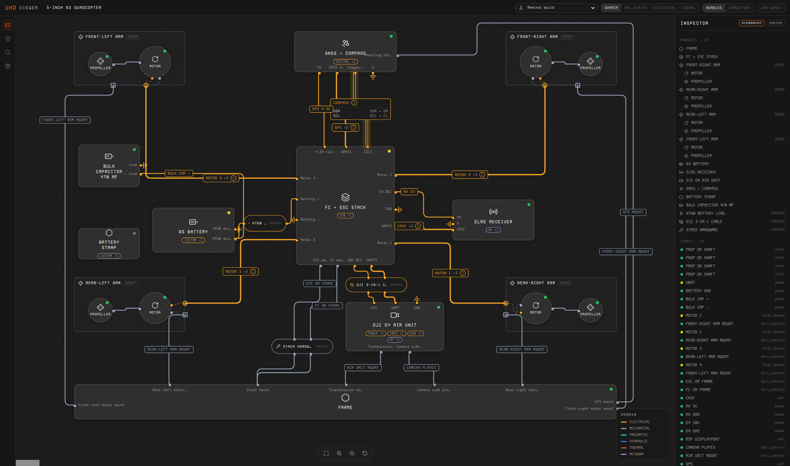

# uhd-viewer

**See a hardware system as a diagram and in 3D, from its UHD description.**

[](https://www.npmjs.com/package/@deltarobotics/uhd-viewer)
[](LICENSE)

`@deltarobotics/uhd-viewer` draws systems described in
[UHD](https://github.com/Delta-Robotics-Inc/OpenUHD) (Universal Hardware
Description, an open language for multidisciplinary hardware): the modules,
their interfaces, the links between them and the harnesses that carry them.
You give it one UHD bundle (a JSON file) and it shows:

- **a system diagram**: modules as cards, links routed between their ports, bundles and cables that open into
  their conductors, colours by domain, signal type or check result, and a module opened as a level of its own;
- **a 3D view**: the system assembled from its mechanical links, with exploded and section views and labels;
- **boards and enclosures**: a board's nets, pins and drawings;
- **a hierarchy and an inspector**: the module tree, and the details, interfaces, checks and files of what is selected;
- **system checks**: supply budgets, bus addresses, interface reuse and the other checks UHD runs, on the
  diagram and in a panel.

It knows only UHD and needs no account or service. It is the viewer of the
[Protoboard stack](https://github.com/Delta-Robotics-Inc/protoboard-stack),
and works the same in any web page, an editor webview or a test harness.



## Install

```bash
npm install @deltarobotics/uhd-viewer
```

Node.js 22 or later for the server; any current browser for the viewer.

## Look at a bundle

The package has a small server for the built viewer, a bundle and the files
the bundle references:

```bash
npx @deltarobotics/uhd-viewer serve path/to/uhd-bundle.json --open
```

It binds to `127.0.0.1:5179`, serves only the files the bundle names as
artifacts, and re-reads the bundle when it changes, so a rebuild shows on
reload. `--port`, `--host` and `--host-origin` (to let another page frame it)
are in the [reference](docs/reference.md#uhd-viewer-serve).

A bundle (`uhd.bundle/v0`, defined in UHD) holds a root module, the
definitions it uses, scenarios, where each definition's files are, and
display hints. The Protoboard stack writes one with `protoboard build`;
[`fixtures/imu-pod/uhd-bundle.json`](fixtures/imu-pod/uhd-bundle.json) in this
repository is a small example.

## Embed it

### The whole viewer in an element

```ts
import { mountViewer } from "@deltarobotics/uhd-viewer";
import "@deltarobotics/uhd-viewer/style.css";

const viewer = mountViewer(document.getElementById("viewer")!, {
  bundleUrl: "/uhd-bundle.json", // or bundle: a parsed bundle
  theme: "system", // "dark", "light", "vscode", or a theme of your own
  onSelectionChanged: (selection) => console.log(selection),
});

viewer.focus("arm_fl/motor"); // drill to a module, select it and bring it into view
viewer.setView("3d");
viewer.update({ bundle: rebuilt }); // after a rebuild
viewer.unmount();
```

The element needs a height; the viewer fills it. This entry bundles React,
three.js and React Flow, so it works on any page.

### React components

For a React app with its own layout, `/components` gives the views on their
own, with React, three.js and React Flow shared with your app:

```tsx
import { ThemeProvider, UhdViewer, DiagramCanvas, ViewerInspector, defaultThemeAdapter } from "@deltarobotics/uhd-viewer/components";
import "@deltarobotics/uhd-viewer/components.css";

export function SystemView() {
  return (
    <ThemeProvider adapter={defaultThemeAdapter("system")}>
      <UhdViewer bundleUrl="/uhd-bundle.json">
        <DiagramCanvas />
        <ViewerInspector />
      </UhdViewer>
    </ThemeProvider>
  );
}
```

Every colour is a theme token (`--uhd-*`); `vscodeThemeAdapter()` follows a VS
Code webview's theme, and `defineTheme` makes your own.

### Driving it from a host

A host can tell the viewer to focus, select, drill into a level or switch
view, and hears what the user selects and opens. The messages are the same
through the handle or, with the viewer in a frame, through `postMessage`:

```js
frame.contentWindow.postMessage({ type: "uhd-viewer:focus", path: "arm_fl/motor" }, viewerOrigin);
window.addEventListener("message", (e) => {
  if (e.data?.type === "uhd-viewer:selectionChanged") show(e.data.selection);
});
```

A framed viewer listens only to the origins its server allows
(`serve --host-origin`).

### Entry points

| Import | What |
| --- | --- |
| `@deltarobotics/uhd-viewer` (+ `/style.css`) | `mountViewer`: the whole viewer in an element, everything bundled |
| `@deltarobotics/uhd-viewer/components` (+ `/components.css`) | The views as React components, the theme provider and adapters, the inspector's details on their own |
| `@deltarobotics/uhd-viewer/headless` | The layout and its metrics without a browser |
| `@deltarobotics/uhd-viewer/serve` | `viewerHandler`: the server's routes for a Node server of your own |
| `@deltarobotics/uhd-viewer/tailwind-theme.css` | The Tailwind 4 theme, for a host's own build |
| `@deltarobotics/uhd-viewer/app/*` | The built standalone app |

The [reference](docs/reference.md) has the rest: every option, the host
messages, URL parameters, pointer and keys, the 3D view, boards and nets,
and how the bundle is read.

## Develop

The viewer builds against UHD's source in a sibling checkout:

```bash
git clone https://github.com/Delta-Robotics-Inc/OpenUHD uhd
git -C uhd checkout v0.3.0
git clone https://github.com/Delta-Robotics-Inc/uhd-viewer
cd uhd-viewer
npm install
npm run dev    # http://localhost:5178/?bundle=<url of a bundle>
npm test
npm run build  # type-check, then the app, the library, the components and the headless entry into dist/
```

[CONTRIBUTING.md](CONTRIBUTING.md) has the details, and how to sign off
your commits.

## Related

- [OpenUHD](https://github.com/Delta-Robotics-Inc/OpenUHD): the description language the viewer reads (`@deltarobotics/uhd`).
- [Protoboard stack](https://github.com/Delta-Robotics-Inc/protoboard-stack): the command line, VS Code extension and agent tools that build UHD bundles from a project, and show them in this viewer.

## Licence

Apache License 2.0: see [LICENSE](LICENSE) and [NOTICE](NOTICE). The fonts are
Kode Mono under the SIL Open Font License 1.1
([OFL.txt](src/styles/fonts/OFL.txt)). Contributions are welcome under the
same licence, with a Developer Certificate of Origin sign-off and no CLA
([CONTRIBUTING.md](CONTRIBUTING.md)). Report security problems privately
([SECURITY.md](.github/SECURITY.md)).

"Protoboard", its logo and the "0" mark are trademarks of Delta Robotics,
Inc.; the licence does not grant them ([TRADEMARKS.md](TRADEMARKS.md)). The
hosted Protoboard cloud (the parts library, accounts and cloud services) is a
separate service with its own terms, not covered by this licence.
