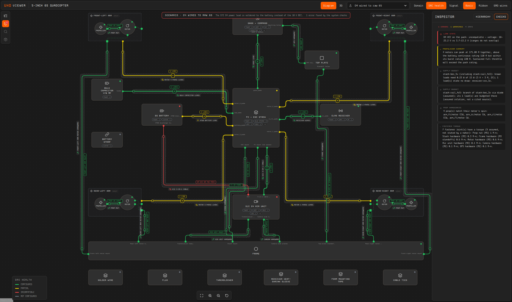

# uhd-viewer

Standalone viewer for UHD (Universal Hardware Description) systems: modules,
interfaces, interface links, and harnesses. It depends on UHD and a neutral
view contract, not on Protoboard types.

Tracking: PB-770 (Track B) under PB-763 in the Protoboard Stack Linear project.




## Run

The viewer imports UHD source from a sibling checkout (`../uhd`) until UHD
ships a JSON form (PB-778). UHD has no part library; parts reach the viewer
inside bundles.

```bash
# ../uhd on branch mark/pb-793-child-link-integrity (or later)
npm install
npm run dev          # http://localhost:5178
npm run build        # type-check, the app (dist/app) and the library (dist/lib)
npm test             # vitest: bundle loading, nets and boards, sample fixtures, the serve entrypoint, host options
npm run serve -- <bundle.json>   # the built app with one bundle (see "Serving and embedding")
```

The package is private (`"private": true`, so `npm publish` refuses it): it is
published only to the stack's local registry, by protoboard-cli's
`scripts/registry/publish-stack.mjs` from a staged copy (`prepack` runs
`npm run build`, so the tarball's `dist/` matches the source). See
protoboard-cli's `docs/guides/local-registry.md`.

Building and testing need `../uhd` only. The dev server's default bundle is the
quadcopter example in a sibling `../protoboard-cli` checkout (or `UHD_BUNDLE`);
without one, open the dev server with `?bundle=<url>`.

To open a particular view, pass URL parameters:

| Parameter | Example | Effect |
| --- | --- | --- |
| `mode` | `domain`, `drc`, `signal` | Selects the classification. |
| `detail` | `conductors` | Draws child links side by side. |
| `open` | `gnss_i2c,m1_phases` | Opens these links. |
| `drill` | `stack` | Opens a child module as the canvas. |
| `expand` | `stack` | Expands a child in place (the arms are expanded by default). |
| `grounds` | `1` | Draws ground links as wires rather than symbols. |
| `scenario` | `o4-on-vbat`, `frame-20mm-stack`, `gps-on-rx-uart`, `two-compasses`, `legacy-m10q` | Loads a fault or variant scenario. |
| `panel` | `checks` | Opens the system checks panel. The hierarchy panel opens by default, except in a view narrower than 760 px (a VS Code panel beside an editor), where the panel and the 3D inspector start closed. |
| `labels` | `1` | Shows the 3D callout labels from the start (off by default: on a small view they hide the model; the 3D toolbar's labels button turns them on). |
| `select` | `node:gnss`, `link:m1_phases` | Selects a module or link. |
| `pair` | `gnss_uart` | Opens the pair view for a link. |
| `select` | `node::sda` | A board net is selected by its path (`:<net>`). |
| `theme` | `light`, `system`, `vscode` | The standalone app's theme (default: the viewer's own dark theme). |

Clicking a link's label selects it; on a bundle (`2 LINKS`, a harness's
lanes) it also opens or closes it, as its +/− box does.

## What the MVP covers

- **Canvas:** React Flow v12, using the alpha app's dark visual language: cards, status dots, a dot grid, ProtoMono and Kode Mono, and Lucide icons.
- **Links (D1, D3):** stored UHD `InterfaceLink`s route orthogonally with filleted corners and stubs at the ports.
  - The layout nudges parallel segments apart and places labels to avoid collisions.
  - Hand waypoints can override the automatic route.
- **Opening links (D4):** the chevron on a link label opens it. The child links (slot → leaf pin) show on the label, as conductors inside a sheath, and in the inspector.
- **Detail level (D5):** *bundled* shows one line with a count; *conductors* draws the child links in parallel with concentric fillets.
- **Ports (D6):** linked ports sit on the outline, on the side facing their counterpart and ordered to reduce crossings.
  - Unlinked ports are grouped by protocol ("UART ×3").
  - Mechanical ports are square.
  - Ground links show as ground symbols; *GND WIRES* draws them as wires instead.
- **Classification (D7):** domain, DRC health (from `validateLinks`), and electrical signal type, each with its own legend.
- **Hierarchy (D8, D9):**
  - Groups (dashed) and modules (solid) expand in place, and double-click toggles expansion.
  - Exports show as boundary ports, with dashed pass-through lines to the child's port.
  - *Open as canvas* drills into a module. Its exports become sheet ports on the canvas edges, and a breadcrumb in the header leads back.
- **Inspector:** by default it shows the hierarchy of modules and links. Selecting a module shows its details and interfaces; selecting a link shows its child links and diagnostics.
- **Layout:**
  - A level's hand layout comes from the bundle's display hints; a level without one lays itself out.
  - A board (a level with nets) is laid out like a schematic sheet (`src/layout/board-layout.ts`):
    - components in columns by function (connectors, power, processor, then sensors and outputs, from their
      taxonomy category); a part driven only by another peripheral (an LED driver's LEDs) one column further out;
    - each passive stacked under the part it serves, on the side its junctions are, so its lines leave the
      cluster without crossing the other stack;
    - net junctions in the channels between columns, level with the parts they join, in one lane where they fit
      (each cluster is given the height its junctions need), and every line leaving its card sideways;
    - a supply rail with five or more members drawn as taps, one beside each cluster it feeds, the way a schematic
      repeats a net label (`src/layout/taps.ts`). Selecting a tap selects the net; the inspector shows the net whole.
  - Lines go round the cards; a link's label sits where it is clear of cards and other labels, or is left off
    (a link that opens into lanes always keeps its label, which carries the toggle).
  - Nodes a hand layout does not name (added since it was saved) are placed next to what they link to, not at the origin.
  - Dragged positions are saved per level in local storage, and the toolbar can reset them.

- **Harness nodes (D2, board 04):** a link carried by a harness module is drawn through the harness pill: the XT60 lead, the DJI 3-in-1 cable, and the M3 stack hardware bus.
- **System checks:** the Checks panel lists `checkSystem` diagnostics: supply budgets, propulsion current, I2C addresses, interface reuse, harness connectors. Clicking one selects its link or module; in DRC mode errors turn links red and warnings yellow.
- **Scenarios:** the header switches between the nominal build and the fault scenarios defined in UHD. A banner explains the fault.
- **Evidence:** a selected part shows its audit result, performance facts, assumptions, source conflicts, open data gaps and sources, all from the part's committed `sources.json` and `verification.json`.
- **Pair view (board 08):** every stored link between two modules, left to right, with crossovers drawn as crossings and each side's unlinked interfaces listed.
- **Remapping child links (D4):** *REMAP* on a link swaps child slots (for example motor phases). The override is stored as `childLinks`, re-validated by UHD (a slot used twice is rejected), locked on the canvas, and kept in local storage.

Not yet built: dragging conductors on the canvas to remap.

## Design

- [`uhd-viewer-design.pen`](uhd-viewer-design.pen): Pencil design file with sample boards 01–08.
- [docs/design-direction.md](docs/design-direction.md): the agreed design decisions (D1–D11).
- [docs/uhd-model-support.md](docs/uhd-model-support.md): what the UHD model supports for each sample.
- `docs/screenshots/`: reference renders of the quadcopter.

## Layout of the code

| Path | Contents |
| --- | --- |
| `src/model/types.ts` | The neutral view contract (PB-784). |
| `src/model/from-uhd.ts` | Adapter from a UHD system `ModuleDef` to the view model. |
| `src/model/classification.ts` | Classification colours and legends. |
| `src/model/nets.ts` | Board nets: junction nodes, grouped membership lines, links derived over nets (PB-823). |
| `src/model/diagnostics.ts` | The viewer's own checks: the root, and each board on its own, re-based onto the root. |
| `src/model/outputs.ts` | Standard outputs by file name, pick-and-place parsing, component rectangles on PCB drawings. |
| `src/layout/board-layout.ts` | Board layout for levels with nets: function columns, passive clusters, junction channels and lanes. |
| `src/layout/taps.ts` | Rail taps: a supply rail drawn beside each cluster it feeds (the canvas's view model only). |
| `src/cad/labels.ts` | 3D callouts: the label solver (side columns ordered by screen y, leaders untangled, no overlaps) and its layer. |
| `src/chrome/BoardInspector.tsx` | Package facts, pin table, net and derived-link details, board drawings with pan and zoom. |
| `src/cad/findings.ts` | Where a finding is on the 3D model. |
| `fixtures/` | Hand-made sample bundles and standard outputs for boards and enclosures (see its README). |
| `src/layout/layout.ts` | Node boxes, port placement, routing, segment separation, and label placement. |
| `src/canvas/routing.ts` | Pure geometry: orthogonal routes, fillets, and parallel offsets. |
| `src/canvas/*.tsx` | Nodes, ports, the link edge, and the canvas. |
| `src/chrome/Chrome.tsx` | The inspector (selection, hierarchy, system checks) and a module's context menu. |
| `src/viewer/` | The viewer's state (`controller.tsx`: `UhdViewer`, `useViewer`), its views (`views.tsx`: `DiagramCanvas`, `Scene3D`, `ViewerInspector`, toolbar, legend) and `renderViewer` (`mount.tsx`, the host channel). |
| `src/ui/` | Primitives: `Toolbar`, `IconButton`, `ToggleGroup`, `Legend`, `InspectorPanel` and friends, `ScrollArea` (Radix), the tooltip layer. |
| `src/theme/` | The theme-token contract (`tokens.ts`), the default themes, the adapters (default, VS Code), `ThemeProvider`. |
| `src/app/` | The plain standalone app: its chrome (header, activity rail), `App.tsx` and `main.tsx`. |
| `src/styles/` | `index.css` (Tailwind 4 layers), `theme.css` (default tokens, generated), `tailwind-theme.css`, `app.css` (the viewer's rules, on tokens), `ui.css`. |
| `src/api.ts` | The host contract: `ViewerOptions`, `ViewerLayout`, `ViewerHandle`, host messages and events. |
| `src/host/` | The host message channel: checking messages and origins, the parent-window channel, what a focus or select names on the model. |
| `src/source/source.ts` | Bundle loading and the default artifact resolver. |
| `src/lib.tsx`, `src/components.ts` | The library entries: `mountViewer` (the app in an element) and the component library. |
| `bin/` | `uhd-viewer serve` (`serve.mjs` holds the server). |

## Component library and theming (PB-909, PB-900)

The package is a component library and a plain app built from it
(protoboard-cli `docs/specs/viewer-stack.md` has the whole stack):

- `@deltarobotics/uhd-viewer` (`mountViewer`): the standalone app in an element, everything bundled.
- `@deltarobotics/uhd-viewer/components` (+ `/components.css`): the views as React components, with
  React, Three, React Flow, Radix and Lucide left to the host. No app chrome.
- `@deltarobotics/uhd-viewer/tailwind-theme.css`: the Tailwind 4 theme for a host's own build.

```tsx
import { ThemeProvider, UhdViewer, DiagramCanvas, ViewerInspector, vscodeThemeAdapter } from "@deltarobotics/uhd-viewer/components";
import "@deltarobotics/uhd-viewer/components.css";

<ThemeProvider adapter={vscodeThemeAdapter()}>
  <UhdViewer bundleUrl="/uhd-bundle.json">
    <DiagramCanvas />
    <ViewerInspector />
  </UhdViewer>
</ThemeProvider>;
```

`renderViewer(element, options, Shell)` mounts a shell of the host's own with
the same handle and host messages as `mountViewer`.

`ModelView` shows one model on its own, outside an assembly (an artifact file
opened by itself): a GLB by `url`, or a scene the host built (`object`, in
millimetres with Z up: a STEP it converted), in the 3D view's scene, lights,
materials and theme colours, with a floating icon toolbar (fit, isometric,
top, front and right views, wireframe, x-ray, ground grid, turn) and a card
with its name and size.

**Theming.** Every colour, surface, shadow and face is a semantic token, read
as a CSS variable `--uhd-<name>` (`src/theme/tokens.ts`: surfaces, text,
borders, accents, domains, signals, DRC and severity, focus and selection,
scrollbars, the 3D scene, shape and type). A theme gives the tokens values;
an adapter says which theme applies and when it changes:

| Adapter | What |
| --- | --- |
| `defaultThemeAdapter("dark" \| "light" \| "system")` | The viewer's neutral themes (dark is the default look). |
| `vscodeThemeAdapter()` | Maps every token onto the `--vscode-*` variables of a webview and follows VS Code's colour theme, high contrast included. |
| `staticTheme(defineTheme(defaultDark, { id, label, tokens: { accent } }))` | A host's own theme: change the accent (tint and glow follow) or any token. |

`mountViewer` takes the same as `theme` (`"dark"`, `"light"`, `"system"`,
`"vscode"`, a theme or an adapter). DRC and severity colours are the same in
every theme. No brand colour is in this package.

Styles are Tailwind 4 (no Preflight; everything in cascade layers, so a host
page's own rules win). Scroll containers are Radix ScrollAreas with thin,
auto-hiding, themed scrollbars; toolbars are icon buttons with tooltips.

## 3D view (PB-775)

`?view=3d` (or DIAGRAM | 3D in the header) shows the system assembled from its
UHD links: every mechanical link with frames on both ends is a mate
(`assemble` in UHD), CAD bodies are the modules' GLB artifacts, and interface
geometry is resolved per binding direction:

- **D1 FEATURE** — named sub-shape in the body artifact (build123d STEP/GLB
  names, vendor component names; KCL tags are listed as unchecked until the
  KCL is exported)
- **D2 ARTIFACT** — the interface's own `interfaces/<id>.glb`
- **D3 PROCEDURAL** — drawn from the interface's parameters at its frame

Click a module to see each interface's frame and binding status; selecting an
interface also highlights its mated counterpart (e.g. motor face ↔ arm pad).
ASSEMBLED / EXPLODED takes the model apart in assembly order along its up direction (PB-899, `src/cad/explode.ts`):
the part at the bottom of each column stays and every part above rises until it clears what it sits on. Two parts
interact only where one lies over the other, so each motor lifts off its own arm. A part held inside another (the other
surrounds it across the axis) comes out through the side the holder leaves open: a cell and a board out of the top of
their case, a seal seated under a cap's ceiling out of its bottom, a probe through the cap's floor out of the side it
sticks out of further; a closed case gives up its parts upward. Otherwise the lower part where they meet comes first
(never the lowest point alone: a cap whose skirt reaches below the bottle's lip comes after the bottle). The heights come
from rays along the axis over each part's outline. A module placed by a mate across the up direction (a camera on the
front) comes off along that mate; an enclosure's bodies made as separate pieces (its exports include `lid.stl`) come
apart, each in the stack; hardware comes apart along its fastener stack. The toolbar is icons only, each named in its
tooltip (the interface-geometry directions too: feature, artifact, procedural);
LABELS shows callouts with leaders for modules, harnesses/hardware and interfaces (menu to pick which), in columns either
side of the model ordered by screen height (then untangled where two would still cross) so leaders do not cross and
cards never overlap, re-solved as the camera moves; a view opened with a section is framed on the part the section keeps;
FRAMES shows every interface frame; CABLES shows the routed wire harnesses;
HARDWARE places the stack harness's fasteners and checks the screw stack-up;
FOCUS looks along the selected interface's normal.

**Cables are harness artifacts.** A wire harness whose end interfaces carry
frames has its own routed body (a GLB in assembly-root coordinates, one node
per conductor, plug housing, solder joint and tinned tip, written by
Protoboard's `@protoboard/ext-harness-cad`). UHD `assemble` places it from the
part its first end lands on (`assembly.harnesses`) and checks every other end;
the viewer draws that GLB at that placement, keeps the generator's colours and
sets the surface per node kind (satin insulation, metal solder). Selecting a
cable shows its length, route, bend radius, clearance and each end's state
(ANCHOR / MATCHES / STALE). Cables fade out when the model explodes: they are
routed for the assembled model. Nothing about a cable is drawn from outside
the bundle.

URL: `view=3d&body=arm_fl/motor&iface=base_mount&dir=feature&explode=14&focus=1`
(also `mate=<link>`, `harness=<path>`, `frames=1`, `wires=0`, `hardware=0`). A vendor body
(the GNSS GLB) comes with the bundle when its terms allow it; the viewer does not generate it.

Stills for review: `node scripts/capture-cad-stills.mjs <out-dir>` renders a
fixed set of shots (assembled from four sides, exploded, labels, stack and
arm close-ups) through `window.__cad.set(...)`; `SHOTS=<regex>` picks some.

Screenshots: `docs/screenshots/cad/`.

### Video

`node scripts/capture-cad-video.mjs docs/video/quadcopter-3d.mp4` records the
3D view (rotation, assembled ⇄ exploded, labels on/off) through
`window.__cad.set(...)` in presentation mode (`?view=3d&present=1`). Needs
the dev server, Google Chrome and an ffmpeg binary (`FFMPEG=...`; e.g. the one
bundled by the `imageio-ffmpeg` Python package). The mp4 is not committed.

## Boards, nets and enclosures (PB-823)

The viewer shows custom boards and enclosures from UHD and the standard
outputs their providers export (protoboard-cli
`docs/specs/tool-integrations.md` §8), read as ordinary artifacts and found by
their fixed file names. It never reads a tool's native files. Design
decisions: D14–D18 in [docs/design-direction.md](docs/design-direction.md).
Samples to try it on: [fixtures/](fixtures/README.md).

- **Diagram.** A board drills in like any module. Each net (UHD `Net`
  interface) is a junction; each component on it has one port and one line
  to it, whose children are its pins. Ground nets are ground symbols unless
  *GND wires* is on. Links UHD derives over the nets are listed by name and
  carried by the lines they run over, so `bus_incomplete` shows as
  `harness_wiring` does on a cable. Every board is checked on its own as
  well as the root; its findings are tagged `IN BOARD` in the checks panel
  and open the board when clicked.
- **Inspector.** A component shows its package facts (`partPackage`) and a
  pin table with each pin's net. A board, or a component on one, shows the
  board's drawings (`pcb-top.svg`, `pcb-bottom.svg`, `schematic.svg`) with
  pan and zoom: the selected component is marked from `pnp.csv`, and a
  click on a component selects it. PCB drawings are taken to be in board
  millimetres (top: board (x, y) at (x, −y); bottom, seen from below:
  (−x, −y)); a drawing that is not is shown without marks.
- **3D.** A board's `board.glb` is its body, placed by its own mates, with
  its components inside it (selectable by instance path). An enclosure's
  `body.glb` with named bodies (`back`, `lid`) comes apart when exploded.
  *Section* cuts the model across X, Y or Z; *X-ray* makes bodies that hold
  others see-through; *Findings* pins errors and warnings (the viewer's own
  and the host's fit and route findings) where they are. It is on by default
  only when the host sent findings that land on the model.

URL: `view=3d&section=y&at=0.4` (`flip=1` keeps the other side), `xray=1`,
`findings=1` or `findings=0`, `body=board&component=u1`.

Screenshots: `node scripts/capture-board-shots.mjs <dev-server-url> <out-dir>`
renders the board and enclosure views of the fixtures.

## Input: a UHD bundle (PB-800)

The viewer loads one UHD bundle (`uhd.bundle/v0`, defined in `@deltarobotics/uhd`)
and nothing else: a root, its definitions, scenarios, per-definition artifact
bases, producer diagnostics and display hints (layout, labels, placement
hints, appearance, keyed by instance path). It never imports a project.

- `?bundle=<url>` picks the bundle; failing that, the bundle URL a server
  injected into the page (`uhd-viewer serve`). The development default is the
  Protoboard quadcopter project's build output (`protoboard build` writes
  `.protoboard/build/uhd-bundle.json`); override it with `UHD_BUNDLE=<path>`.
  A production build has no default.
- Absolute filesystem artifact bases are served through Vite's `/@fs` route in
  development only. A production build cannot fetch them: serve the bundle
  with `uhd-viewer serve`, or give `mountViewer` a resolver. URL bases are used
  as they are.
- Producer diagnostics (the bundle's `diagnostics`) and a host's are listed in
  the checks panel under FROM THE PRODUCER, for the nominal build. Findings
  from `uhd/checkSystem` are left out there, since the viewer runs those checks
  itself for every scenario.
- Part evidence: the inspector shows a part's evidence traits from the bundle.
  The audit result and source list come from the part's `sources.json` and
  `verification.json`, which bundles do not carry yet and UHD has no part
  library to read them from, so the inspector shows the traits only.
  `registerEvidenceFiles` (`src/model/evidence.ts`) is the hook for supplying
  them; nothing calls it yet.
- Without display hints, the diagram lays itself out and 3D labels are derived
  from instance names, harness children and mates; the assembly is placed from
  the top-level module with the most interface frames.
- The 3D view opens fitted to the whole assembly once every model has loaded.
  `spatial.view` in the display hints can set how it opens: `up` (the model
  direction drawn up, default `[0, 0, 1]`; a watch modelled display-down says
  `[0, 0, -1]`) and `camera` (`azimuth`, `elevation` in degrees about `up`,
  `distance` in mm, `target`; without a distance the model is still fitted).
  The URL's `az`, `el` and `dist` override it.

Boundary: `protoboard-cli/docs/specs/uhd-boundary.md`.

## Serving and embedding (PB-814)

`npm run build` writes two things:

- `dist/app`: the standalone viewer, with relative asset URLs so it can be
  served from any path. It loads `?bundle=<url>` or the bundle URL a server
  injects, and resolves artifacts over HTTP.
- `dist/lib`: `uhd-viewer.js` (one ES module that includes React, Three and
  React Flow), `uhd-viewer.css`, and type declarations.

### `uhd-viewer serve`

```bash
uhd-viewer serve <bundle.json> [--port 5179] [--host 127.0.0.1] [--host-origin <origin>]… [--open]
# from this checkout: npm run build && npm run serve -- <bundle.json>
```

A small Node server (`bin/serve.mjs`, no dependencies) for the built app, the
bundle and its artifacts:

- `/` is the app, with the bundle URL (and the `--host-origin` origins, if
  any) injected as `<script type="application/json" id="uhd-viewer-config">`.
- `/uhd-bundle.json` is the bundle with every filesystem artifact base
  rewritten to a URL on this server, `/artifacts/<name>/` (named after the
  base's folder: `quadcopter-5in`, `uhd`). URL bases are left alone, and no
  local path is sent to the browser.
- `/artifacts/<name>/<path>` answers only for files the bundle references as
  artifacts, and only if the file's real path stays inside its base. Anything
  else in the folder (`.env`, sources) is a 404; a symlink pointing out of the
  base is a 403.
- The bundle file is re-read when it changes, so a rebuild shows on reload.
- It binds to 127.0.0.1 and only answers requests addressed to a loopback
  name, so a web page elsewhere cannot read the files through DNS rebinding.
  `--host 0.0.0.0` exposes the artifacts to the network and accepts any host.
- `--host-origin <origin>` (repeatable, or comma-separated; exact,
  `scheme://*` or `*`) lets a page on that origin frame the app and drive it
  with host messages (see "Host messages"). Without it only a parent on the
  app's own origin can.

Hosts with their own server can use the same handler for the viewer's routes:
`viewerHandler({ bundleFile, hostOrigins? })` from `@deltarobotics/uhd-viewer/serve`. Its
types are in `bin/serve.d.mts` (written by hand; a test checks they name
exactly what the module exports).

### `mountViewer`

```ts
import { mountViewer } from "@deltarobotics/uhd-viewer";
import "@deltarobotics/uhd-viewer/style.css";

const viewer = mountViewer(document.getElementById("viewer")!, {
  bundleUrl: "/uhd-bundle.json",          // or bundle: <a parsed UhdBundle>
  resolveArtifact: (definitionId, filePath, fallback) => fallback(definitionId, filePath),
  diagnostics: hostFindings,              // UhdBundleDiagnostic[], listed with the producer's
  layout: savedEdits,                     // ViewerLayout to show
  onLayoutChange: (layout) => save(layout),
});
viewer.update({ bundle: rebuilt });       // e.g. after a rebuild
viewer.update({ layout: reloaded });      // e.g. the saved layout changed on disk
viewer.unmount();
```

- The element needs a height; the viewer fills it.
- `resolveArtifact` replaces or extends the default resolver (the bundle's
  artifact bases); `fallback` is the default.
- `diagnostics` are listed with the bundle's own under *FROM THE PRODUCER*.
  Like those, they describe the nominal build, so they show for the nominal
  scenario only.
- `update` merges its options into the current ones. Giving `bundleUrl`
  without `bundle` drops a bundle given earlier and loads from the URL.
- `onLayoutChange` receives, debounced, every layout edit the user makes:
  dragged node positions and link waypoints / label positions, per drill level
  (`ViewerLayout`). With a handler the host owns the layout: the viewer neither
  reads nor writes it in local storage. Without one, local storage is used as
  before. Child-link remaps (*REMAP*) stay in local storage either way.
- A different `layout` given to `update` replaces the viewer's edits (an edit
  still waiting for its debounce is dropped). The same layout coming back, as
  after the host saves what it was sent and reloads it, changes nothing and is
  not sent again.
- View state still comes from the page's URL parameters (the table under
  "Run").
- The stylesheet is not scoped yet: it sets `html`, `body`, `button` and the
  fonts, so the viewer is best given a page of its own (as `protoboard dev`
  will).

### Host messages

A host can drive the viewer and hear what the user does in it, through the
handle or, with the viewer in a frame, through `window.postMessage`. The
messages are the same either way:

| Direction | Message | Meaning |
| --- | --- | --- |
| host → viewer | `{type: "uhd-viewer:focus", path}` | Drill to the level that holds the module at instance path `path` (`"arm_fl/motor"`), select it, open the inspector and bring the module into view. A module already drawn on the current level (also inside a module expanded in place) is selected there. In the 3D view its body is selected and looked at. |
| | `{type: "uhd-viewer:select", ids, reveal?}` | Select the first of `ids` drawn on the current level: a module, a net, or a link. Ids are canonical (as `selectionChanged` reports them) or relative to the level; `node:` and `link:` prefixes pick the kind. An empty list clears the selection. When the selection is off screen or under the inspector, the diagram pans to it (zooming out only if it must, never in); `reveal: false` leaves the view where it is. In the 3D view it selects there too, without moving the camera: the module's body (or, for an id not on the diagram's level, the first full instance path) or the mate of a link; nets and links without a mate are not drawn in 3D, so they leave the 3D selection alone. |
| | `{type: "uhd-viewer:drill", path}` | Show the level of an instance path (`""` is the root), as far as it names modules with children. A level of the diagram: the 3D view shows the whole assembly at any level, so there it sets the level the diagram returns to. |
| | `{type: "uhd-viewer:setView", view}` | `"diagram"` or `"3d"`. |
| viewer → host | `{type: "uhd-viewer:ready"}` | The model is on screen. Messages sent earlier wait for it. |
| | `{type: "uhd-viewer:selectionChanged", selection}` | Every change of the selection, in the diagram or the 3D view: `{kind: "node" \| "link", id, defId?}` or `null`. Ids are canonical paths from the root: a module's instance path, a net or boundary interface as `board:v3v3`, a link as its owner's path and id (`stack/fc_esc`, as UHD's system checks name links). `defId` is the module's definition (for a link, the module that declares it). |
| | `{type: "uhd-viewer:openSource", defId, instancePath?}` | The user asked for a module's source: *OPEN SOURCE* in the inspector (modules and links) or a module's context menu (right-click, on the canvas or in the hierarchy). Offered only when a host takes it. |
| | `{type: "uhd-viewer:openArtifact", defId, artifactId}` | The user picked an artifact file row in the inspector. Without a host the row opens the file in a new tab, as before. |
| | `{type: "uhd-viewer:openModule", path}` | The user asked to open a module on its own: a double-click on it, or *OPEN IN NEW TAB* in its context menu. `path` is its instance path from the root. Only with `onOpenModule` (a host that opens modules in tabs of their own); without it a double-click expands the module in place. |
| | `{type: "uhd-viewer:openPair", linkId, a, b}` | The user asked for the pair view of a link (the button on the inspector's pair preview). `linkId` as `selectionChanged` names links; `a` and `b` are the instance paths of the two modules it joins. Sent only when the host takes it (`onOpenPair`); otherwise the viewer opens its own pair view over the diagram. |

With `mountViewer`, the handle has `focus(path)`, `select(ids, { reveal? })`,
`drill(path)` and `setView(view)`, and `post(message)` for a message object as
it arrives; the options take `onReady`, `onSelectionChanged`, `onOpenSource`,
`onOpenArtifact`, `onOpenModule` and `onOpenPair`. Giving `onOpenSource` turns
on the *OPEN SOURCE* actions; giving `onOpenArtifact` hands artifact rows to
the host; giving `onOpenModule` makes a double-click open the module
(expanding it in place stays in its context menu); giving `onOpenPair` hands
the pair view to the host (a tab of its own).

Selecting a link shows a small preview of the pair in the inspector: the two
modules and the link's conductors from one to the other (a crossover
crosses), with a button that opens the pair view.

`parentWindow: true | { origins }` connects a mounted viewer to its parent
window instead (or as well): host messages are taken from `window.parent`
only, and only from the listed origins (exact origins, `scheme://*`, or `*`;
default: the page's own origin); events are posted to the parent at its
origin (the frame's ancestor origin or referrer when allowed, else the only
listed origin, else the origin of the parent's first message, with events
held until then). The open actions then go to the parent.

The standalone app (`uhd-viewer serve`, `dist/app`) does this by itself when
it is in a frame whose parent is on its own origin, or on one its server
allows: `hostOrigins` in the injected config, which `uhd-viewer serve
--host-origin <origin>` (for example `--host-origin 'vscode-webview://*'`) and
`viewerHandler({ hostOrigins })` write. The allowed origins never come from
the frame's URL, since the page doing the framing writes that URL and could
name itself. The Vite dev server is the exception: there
`?hostOrigin=<origin>[,<origin>…]` is honoured, for trying a host locally. In
a frame it was not told about, and in a tab of its own, it ignores messages
and posts nothing. Nothing in the
protocol names an editor: a web page, an IDE webview or a test harness talk to
it the same way.

### Checking a build

`node scripts/check-render.mjs <viewer-url> <out-dir>` opens the diagram, two
inspector artifact previews, the checks panel and the 3D view in headless
Chrome, saves a PNG of each with `summary.json`, and exits 1 if any request
failed (a missing favicon aside). `node scripts/check-render.mjs compare
<dir-a> <dir-b>` compares two runs pixel by pixel, for example the dev server
against `uhd-viewer serve` on the same bundle. On the quadcopter bundle the
two match except for the evidence audit line, which only development shows
(see "Input").

The `<bundle.json>` the `host` and `messages` forms take (and the bundle a
viewer URL serves) is the project's build bundle,
`<project>/.protoboard/build/uhd-bundle.json`, written by `protoboard build`
with absolute artifact bases on this machine, which the viewer's server
resolves. Not
the release's model bundle (`release/<version>/system/files/model/uhd-bundle.json`):
that one records artifact bases relative to the project for the package's
readers, so the 3D view and the artifact previews find no files and the
check fails on missing requests.

`node scripts/check-render.mjs host <bundle.json> <out-dir>` checks the library
build as a host uses it: a page that mounts `dist/lib` with its own
diagnostics, resolver and `onLayoutChange`, next to `viewerHandler`. It checks
that the host's diagnostics are listed and replaced by `update`, that a dragged
node reaches `onLayoutChange` and not local storage, that a layout passed back
through `update` moves the node and is not sent again, that the 3D view
resolves its artifacts through the host's resolver, and that no request fails.
It also checks the handle's host methods: `onReady`, `focus` reaching
`onSelectionChanged`, and no *OPEN SOURCE* without `onOpenSource`. It writes
two PNGs and `host-summary.json`, and exits 1 on any failure.

`node scripts/check-render.mjs messages <bundle.json> <out-dir>` drives the
built app through host messages as a framing host does: the app on one origin
(`localhost`), framed by a page on another (`127.0.0.1`) that its server
allows (`viewerHandler({ hostOrigins })`). On the quadcopter it checks that the frame posts `ready`; that
`drill` opens the stack; that `focus` on `arm_fl/motor` from there opens the
arm, selects the motor, brings it into view clear of the inspector and reports
it with its definition; that `select` takes the first id on the level (a link
given by the second half of a cable, `dji_o4`, selects the line `dji_fc`);
that `select` with `reveal: false` leaves a zoomed-in view where it is, and
without it brings the off-screen cable into view clear of the inspector;
that *OPEN SOURCE* and an artifact row reach the host and no tab opens; that
events go to the host's origin only; that `setView` switches to the 3D view,
where `focus` selects the body, and back; and that a frame not told about the
page's origin ignores it and posts nothing, even when the frame's URL carries
`?hostOrigin=` naming the page. It also checks that `select` in the 3D view
selects there and is reported. It writes two PNGs (with page rasterization on the
CPU: in software GL a frame on another origin otherwise keeps stale tiles of
earlier levels in its screenshots, nodes that are not in the DOM) and
`messages-summary.json`, and exits 1 on any failure.
